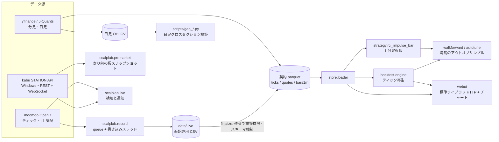

**[English](README.md) | [日本語](README.ja.md)**

# scalplab

日本株デイトレの研究環境です。証券会社のフィードからティックを録画し、バックテストエンジンで再生し、毎晩アウトオブサンプルで手法を評価して、結果を小さな Web UI で確認できます。

研究・検証用のツールであり、投資助言ではありません。注文も出しません（[リアルタイム連携](#リアルタイム連携)を参照）。成績の数値は意図的に載せていません。根拠となるデータはリポジトリに含まれず、このプロジェクトの価値は結果ではなく方法にあるためです。

## 技術的に面白いところ

**クラッシュに強いティック録画。** 録画デーモン（`scalplab/record.py`）はセッション中、プレーンな CSV に行を追記するだけです。push コールバックは行を queue に積み、単一の書き込みスレッドがそれを処理します。セッション終了時（またはクラッシュ後の救済実行）に `scalplab/store/finalize.py` が CSV を契約 parquet へ変換し、連番で重複を排除してスキーマを強制します。1 銘柄の失敗（権限なし・クォータ超過）はログに残してスキップし、全銘柄が失敗したときだけ異常終了します。データが一定時間届かなければウォッチドッグが再接続します。

**録画側とバックテスト側の間のデータ契約。** `docs/data-contract.md` に ticks / quotes / 1 分足のスキーマと時刻規約（JST・タイムゾーンなし）を定義しています。書き込み・finalize・読み込みが同じ強制関数を使うので、両側がずれません。1 分足は録画ティックから合成します。yfinance や J-Quants の分足は出自を明記したフォールバックとして受け入れますが、ティック由来の分足は上書きしません。

**ベクトル化経路を持つティック再生バックテスト。** 研究対象の手法は足の*内部*での RCI（順位相関指数）の傾きに反応するので、確定足だけでは検証できません。`scalplab/backtest/engine.py` は録画ティックを時刻順に流し、1 分足を合成しながらティックごとに足内 RCI を再計算します。しきい値に依存しない特徴量は銘柄×日ごとに一度だけ前計算し（`compute_tick_features`）、パラメータグリッドで使い回します（`signals_from_features`）。`tests/test_engine_parity.py` がベクトル版と逐次版の一致を検証します。評価はエントリー品質のみで、固定ホライズンの先行リターンと MFE/MAE をコスト前後で出します。

**指標は自前実装。** RCI（同順位は平均順位・バッチ版と足内版）、Parabolic SAR、ATR を `scalplab/indicators/` に実装し、黄金値テストとバッチ版・逐次版の一致テストで固めています。

**日足でのギャップリバーサル研究。** `scripts/` のスクリプトがクロスセクション戦略を検証します。`gap_sigma`（寄りのギャップを、前 20 営業日の日次リターンの標準偏差で割った値。寄り時点で既知になるよう 1 日ずらす）で銘柄を並べ、下位数%を寄りで買って引けで売ります。市場中立版は、同じ日の日中リターンのクロスセクション中央値を差し引きます。検証方法は[手法の研究](#手法の研究)を参照してください。

**毎晩のアウトオブサンプル蓄積。** `scalplab/backtest/walkforward.py` は現行チャンピオンのパラメータを変えずに新しい録画へ流し、結果をレポートに追記します。`(date, params_hash)` について冪等なので、録画デーモンの再起動で二重集計されません。`scalplab/backtest/autotune.py` は学習・検証分割（最新日より前を学習、最新日を検証）でパラメータグリッドを探索し、複数セッション連続でチャンピオンを上回った挑戦者に印を付けます。チャンピオンの自動差し替えはせず、判断は人が行います。

**リアルタイム連携の構造。** `scalplab/live.py` はデータ源を `TickSource` で抽象化しています（moomoo OpenD または kabu STATION）。kabu STATION 側は REST API と、標準ライブラリだけで書いた WebSocket クライアント（RFC 6455 のフレーミング）を使います。`/board` が登録枠を消費するため、`scalplab/premarket.py` は 50 銘柄ずつのバッチに分け、各バッチの前に `PUT /unregister/all` を呼んで、約 290 銘柄を枠エラーなしで巡回します。通知は OS ごとに分岐します（macOS は `osascript`、Windows は PowerShell の WinRT トースト）。

**フレームワークなしの Web UI。** `scalplab/webui/` は `ThreadingHTTPServer` と素の JavaScript だけです。指標はすべてサーバ側でバックテストと同じモジュールを使って計算するので、チャートの表示とバックテストの数値は構造的に一致します。サーバは既定でループバックにだけ bind し、外部の `Host` / `Origin` を拒否し（CSRF・DNS rebinding 対策）、パストラバーサルを防ぎ、入力を検証します。

**運用まわり。** 録画デーモン用の launchd テンプレート、API ポートを監視してアプリを再起動する OpenD ヘルスガード（プロセスは生きているのにポートだけ死んでいる状態も扱います）、ログの自動掃除を `scripts/` に置いています。

## アーキテクチャ



## 手法の研究

リポジトリには、うまくいかなかったものも含めて、たどった道筋を残しています。

1. **ティック駆動の RCI × Parabolic SAR 戦略**（`scalplab/strategy/rci_impulse.py`。ティックが取れない銘柄向けに 1 分足近似の `rci_impulse_bar.py` もあります）。パラメータグリッド、学習・検証分割、毎晩のウォークフォワードで調べました。コードには残っていますが、コストを正しく、つまり片道ではなくスプレッドを含む往復で引くとエッジが消えました。この誤りは `docs/troubleshooting.md` に記録しています。
2. **先読みの点検。** ギャップ研究の初期版は、当日の終値を含む特徴量を使っていました。症状は非現実的に良い結果でした。修正は `scripts/gap_fixed.py` にあり、すべての特徴量を 1 日ずらして、寄り時点で分かる情報だけを許しています。教訓は `docs/troubleshooting.md` に規則として書いてあります。結果が良すぎるときは、まずパイプラインを疑うこと。
3. **日足でのギャップリバーサル**（`scripts/gap_pf.py`、`gap_fixed.py`、`gap_verify.py`、`portfolio.py`、`multi.py` ほか）。行っている点検は次のとおりです。
   - 日付での学習・検証分割と、特徴量×ゾーンの組み合わせにわたる学習結果と検証結果の相関（標本内の順位が先へ持ち越されるかの粗い確認）
   - 平均だけでなく、日次リターン系列の週次・月次・年次の勝率
   - コスト感度: 往復コスト 3bp から 50bp まで、同じポートフォリオで確認
   - 録画デーモン自身が録った 1 分足での再現（第二のデータ源）
4. **未解決なのは執行。** エッジは寄り付きの板寄せに集中しているため、実運用には寄り前の気配に基づいて動く必要があります。`scalplab/premarket.py` はその気配を（読み取り専用で）録り、寄り値をどれだけ予測できるかを測るための生データを貯めます。このリポジトリには注文を出すコードはありません。

`data/.cache/daily-300.parquet` を読むスクリプトは、先にこれを作る必要があります。`python -m scalplab.datafeed.universe --full-scan` で流動プール（`data/universe/pool.csv`。銘柄マスタの取得に OpenD が必要）を作り、続けて `scripts/fetch300.py` が yfinance から 6 年分の日足を取得します。

## テスト

```bash
python -m pytest tests/
```

23 ファイル・285 のテスト関数から 290 件が収集されます（差はパラメータ化ケース）。実行は約 7 秒です。すべてオフラインで動き、ネットワーク・OpenD・kabu STATION はモックか合成データに置き換えています。対象は、指標（黄金値）、戦略ゲート、ベクトル版と逐次版のエンジン一致、ウォークフォワードと autotune の記録処理、store 層、録画デーモンの単体ロジック、ライブ検知と kabu アダプタ、寄り前バッチ処理、universe 選定、Web UI の API ハンドラです。

`scripts/ui_smoke.sh` は Web UI 用の別建てのブラウザスモークテストです。録画データ、macOS、Chrome が必要なので、pytest には含まれません。

規模（実測）: Python 約 18,100 行（ライブラリ 10,730・スクリプト 1,984・テスト 5,380）、フロントエンド（JS・CSS・HTML）約 2,600 行、シェル・PowerShell・バッチ・plist 約 900 行。

## セットアップ

Python 3.12（テストスイートは 3.12.13 で実行しました）。

```bash
python3.12 -m venv .venv
.venv/bin/pip install -r requirements.txt
.venv/bin/python -m pytest tests/
```

実フィードで動かすには、さらに次が必要です。

| 構成要素 | 用途 | 備考 |
|---|---|---|
| moomoo OpenD（起動・ログイン済み） | ティック録画、米国株のライブ検知 | `python -m scalplab.datafeed.check` で接続と権限を確認 |
| kabu STATION（Windows・API 有効） | 日本株のライブ検知、寄り前録画 | API パスワードは `config/live.yaml` で指定した環境変数（`KABU_API_PASSWORD`）から読み、リポジトリには値を置きません |
| J-Quants API キー（任意） | 公式 1 分足 | `JQUANTS_API_KEY`、または macOS キーチェーンの項目 `jquants-api-key` から読みます。キーが無い場合はどの経路も静かにスキップします |

主なコマンド:

```bash
.venv/bin/python -m scalplab.record                 # 当日の東証セッションを録画（米国は --market US）
.venv/bin/python -m scalplab.backtest.run --date 2026-07-16
.venv/bin/python -m scalplab.backtest.scan          # パラメータグリッド
.venv/bin/python -m scalplab.backtest.walkforward --date 2026-07-16
.venv/bin/python -m scalplab.webui                  # http://127.0.0.1:8025
.venv/bin/python -m scalplab.live --check           # 接続・購読の疎通確認（10 秒）
```

録画データ・ログ・レポートは `data/`、`logs/`、`reports/` に出力され、いずれも git の管理外です。kabu STATION 用の Windows セットアップは `docs/windows-setup.md` にあります。

## 設定

| ファイル | 用途 |
|---|---|
| `config/recorder.yaml` | 購読種別、セッション時刻、ウォッチドッグのタイムアウト |
| `config/universe.yaml`, `config/universe_us.yaml` | 録画する銘柄（固定リスト + 自動ランキング） |
| `config/live.yaml` | ライブ検知: データ源、監視銘柄、パラメータ、通知音。マシン固有の上書きは `config/live.local.yaml`（git 管理外） |
| `config/best-params*.yaml` | ウォークフォワードが使うチャンピオンパラメータ（出自メモ付き） |
| `config/premarket.yaml` | 寄り前録画のスケジュールと銘柄リスト |
| `config/scan*.yaml`, `config/screen*.yaml` | パラメータグリッド |
| `config/jp_names.csv` | UI 用の社名マスタ（任意。同梱しません。下記参照） |

**社名マスタ。** `config/jp_names.csv`（列は `code,name`。例 `JP.7203,トヨタ自動車`）は JPX / J-Quants のデータに由来するため配布していません。形式は `config/jp_names.sample.csv` を見てください。実物を作るには、J-Quants API から上場銘柄情報を取得し、銘柄ごとに `JP.` + 東証の 4 桁コードで 1 行ずつ書きます。ファイルが無い場合、UI はコードだけを表示します。

## リアルタイム連携

`scalplab.live` はライブのティックからエントリー条件を検知してデスクトップに通知し、シグナルを `logs/live-signals-YYYY-MM-DD.csv` に追記します。注文の発行・変更・取消はしません。コードを検索しても注文用のエンドポイントは見つかりません。kabu STATION への呼び出しはトークン、`register`、`unregister`、`board`（相場情報）だけで、moomoo 側はティックの購読だけです。建玉の決済は画面を見ている人に任せています。注文の経路そのものが無いので、ドライランや確認のフラグはありません。

## 制約

- 結果は同梱していない録画データに依存します。データなしでは、コードを読むことと（合成データを使う）テストスイートの実行はできますが、研究の出力を再現することや実際のチャートを見ることはできません。
- ギャップ研究の日足パネルは、現在の売買代金で選んだ流動性の高い銘柄の集合なので、生存者バイアスと選択バイアスがあります。
- 日足バックテストは、寄りと引けの気配値どおりに固定コストで約定できる前提です。板寄せでそれが実現できるかは上に書いた未解決の論点です。
- RCI 戦略の 1 分足近似はティック版より情報が少なく、絶対的な期待値ではなく相対的な順位として読むべきものです。
- ウォークフォワードの結果は、新しいセッションが十分に貯まって初めて意味を持ちます。最初のチャンピオン選定は標本内です。
- 主に macOS で検証しています。Windows 用スクリプト（kabu STATION、タスクスケジューラ）は特定の 1 台に合わせて書いたもので、移植性は低めです。
- `tests/fixtures/matsui_tick_page*.html` は、公開ランキングページを切り詰めた抜粋で、パーサのテストにだけ使います。`scalplab/datafeed/jp_tick_ranking.py` はそのページを素の `urllib` リクエストで取得します。実行する前にサイトの利用規約を確認してください。

## ライセンス

MIT。[LICENSE](LICENSE) を参照してください。同梱の TradingView Lightweight Charts（Apache-2.0）は [THIRD_PARTY_NOTICES.md](THIRD_PARTY_NOTICES.md) に記載しています。
