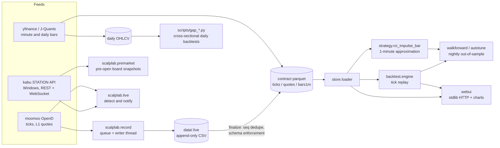

**[English](README.md) | [日本語](README.ja.md)**

# scalplab

A research environment for Japanese-equities day trading: it records tick data from a broker feed, replays it through a backtest engine, evaluates strategies out of sample every night, and shows the result in a small web UI.

This is a research and verification tool. It is not investment advice, and it does not place orders (see [Live integration](#live-integration)). No performance figures are given here on purpose: the data behind them is not part of the repository, and the point of the project is the method, not a result.

## What is technically interesting

**Tick recording that survives crashes.** The recorder (`scalplab/record.py`) only appends rows to a plain CSV while the session runs; push callbacks put rows on a queue and a single writer thread drains it. At session end (or in a rescue run after a crash) `scalplab/store/finalize.py` converts the CSV into the contract parquet, de-duplicating by sequence number and enforcing the schema. A failure for one symbol (no permission, quota) is logged and skipped; the run only fails if every symbol fails. A stale-data watchdog reconnects when nothing arrives for a configurable time.

**A data contract between recorder and backtest.** `docs/data-contract.md` defines the ticks / quotes / 1-minute-bar schemas and the time convention (JST, timezone-naive). The same enforcement function is used by the writer, finalizer and loader, so the two sides cannot drift apart. 1-minute bars are synthesised from recorded ticks; yfinance and J-Quants minute bars are accepted as a labelled fallback and never overwrite tick-derived bars.

**Tick-replay backtest with a vectorised path.** The strategy being studied reacts to the slope of an RCI (rank correlation index) *inside* a bar, so closed bars are not enough. `scalplab/backtest/engine.py` replays recorded ticks in time order, rebuilds 1-minute bars as it goes, and recomputes the intrabar RCI per tick. Threshold-independent features are precomputed once per symbol-day (`compute_tick_features`) so a parameter grid can reuse them (`signals_from_features`). `tests/test_engine_parity.py` checks the vectorised path against the sequential strategy. Evaluation is entry quality only: forward returns at fixed horizons and MFE/MAE, before and after cost.

**Indicators implemented from scratch.** RCI (average rank for ties, batch and intrabar variants), Parabolic SAR and ATR live in `scalplab/indicators/` and are covered by golden-value tests plus batch-versus-sequential equality tests.

**Gap-reversal research on daily bars.** Scripts in `scripts/` study a cross-sectional strategy: rank stocks by `gap_sigma` (the opening gap divided by the standard deviation of the previous 20 daily returns, shifted one day so it is known at the open), buy the lowest few percent at the open and sell at the close. The market-neutral variant subtracts the same-day cross-sectional median of the intraday return. See [Strategy research](#strategy-research) for how it is validated.

**Nightly out-of-sample accumulation.** `scalplab/backtest/walkforward.py` runs the current champion parameters, unchanged, on each new recording and appends the result to a report. It is idempotent on `(date, params_hash)`, so a recorder restart does not double count. `scalplab/backtest/autotune.py` searches a parameter grid with a train/validation split (train on all earlier days, validate on the newest) and flags challengers that beat the champion several sessions in a row. It never replaces the champion automatically; that stays a human decision.

**Live integration structure.** `scalplab/live.py` abstracts the data source behind `TickSource` (moomoo OpenD, or kabu STATION). The kabu STATION adapter uses the REST API plus a WebSocket client written against the standard library only (RFC 6455 framing). Because `/board` consumes registration slots, `scalplab/premarket.py` rotates through 50-symbol batches and calls `PUT /unregister/all` before each batch to cover about 290 symbols without slot errors. Notifications branch per OS (`osascript` on macOS, a PowerShell WinRT toast on Windows).

**Web UI with no web framework.** `scalplab/webui/` is a `ThreadingHTTPServer` plus vanilla JavaScript. All indicators are computed server-side with the same modules the backtest uses, so what the chart shows and what the backtest measures are the same numbers by construction. By default the server binds to loopback only, rejects foreign `Host` / `Origin` headers (CSRF and DNS rebinding), guards against path traversal and validates inputs.

**Operations.** launchd templates for the recorder, an OpenD health guard that checks the API port and restarts the app (including the case where the process is alive but the port is dead), and a log garbage collector are in `scripts/`.

## Architecture



## Strategy research

The repository keeps the route taken, including what did not work.

1. **Tick-driven RCI x Parabolic SAR strategy** (`scalplab/strategy/rci_impulse.py`, with a 1-minute-bar approximation in `rci_impulse_bar.py` for symbols where ticks are not available). It was explored with parameter grids, a train/validation split and nightly walk-forward. It stayed in the code, but the edge disappeared once the cost was accounted for correctly, as a round trip including the spread instead of one way. `docs/troubleshooting.md` records that mistake.
2. **Look-ahead check.** An early version of the gap study used a feature that contained the same day's close. An implausibly good result was the symptom. The fix is in `scripts/gap_fixed.py`: every feature is shifted one day, and only information known at the open is allowed. The lesson is written down as a rule in `docs/troubleshooting.md`: when a result looks too good, suspect the pipeline first.
3. **Gap reversal on daily bars** (`scripts/gap_pf.py`, `gap_fixed.py`, `gap_verify.py`, `portfolio.py`, `multi.py`, ...). Checks that are run:
   - train/test split by date, and the correlation between train and test results across feature and zone combinations (a rough test of whether an in-sample ranking carries forward);
   - weekly, monthly and yearly hit rates of the daily return series, not just the mean;
   - cost sensitivity: the same portfolio at round-trip costs from 3 bp up to 50 bp;
   - replication on 1-minute bars recorded by the recorder itself, as a second data source.
4. **Execution is the open question.** The edge is concentrated in the opening auction, so a real implementation would have to act on pre-open quotes. `scalplab/premarket.py` records those quotes (read-only) to measure how well they predict the opening price. Nothing in this repository sends an order.

Scripts that read `data/.cache/daily-300.parquet` need it built first: `python -m scalplab.datafeed.universe --full-scan` builds the liquidity pool (`data/universe/pool.csv`, needs OpenD for the symbol master), then `scripts/fetch300.py` downloads six years of daily bars from yfinance.

## Tests

```bash
python -m pytest tests/
```

290 tests are collected from 285 test functions in 23 files (parametrised cases account for the difference); they run in about 7 seconds. They are offline: network calls, OpenD and kabu STATION are mocked or replaced by synthetic data. Areas covered: indicators (golden values), strategy gates, vectorised-versus-sequential engine parity, walk-forward and autotune bookkeeping, the store layer, the recorder's unit logic, the live detector and the kabu adapter, premarket batching, universe selection, and the web UI API handlers.

`scripts/ui_smoke.sh` is a separate browser smoke test for the web UI. It needs recorded data, macOS and Chrome, so it is not part of the pytest run.

Size, measured: about 18,100 lines of Python (library 10,730, scripts 1,984, tests 5,380), plus about 2,600 lines of front-end (JS, CSS, HTML) and about 900 lines of shell, PowerShell, batch and plist files.

## Setup

Python 3.12 (the test suite was run on 3.12.13).

```bash
python3.12 -m venv .venv
.venv/bin/pip install -r requirements.txt
.venv/bin/python -m pytest tests/
```

Running against real feeds needs more:

| Component | Needed for | Notes |
|---|---|---|
| moomoo OpenD (running, logged in) | tick recording, US live detection | `python -m scalplab.datafeed.check` verifies connection and permissions |
| kabu STATION (Windows, API enabled) | Japanese live detection, pre-open recording | API password is read from the environment variable named in `config/live.yaml` (`KABU_API_PASSWORD`); no value is stored in the repository |
| J-Quants API key (optional) | official 1-minute bars | read from `JQUANTS_API_KEY`, or the macOS Keychain item `jquants-api-key`; every path skips quietly when no key exists |

Common commands:

```bash
.venv/bin/python -m scalplab.record                 # record today's session (JP); --market US for the US session
.venv/bin/python -m scalplab.backtest.run --date 2026-07-16
.venv/bin/python -m scalplab.backtest.scan          # parameter grid
.venv/bin/python -m scalplab.backtest.walkforward --date 2026-07-16
.venv/bin/python -m scalplab.webui                  # http://127.0.0.1:8025
.venv/bin/python -m scalplab.live --check           # connection and subscription check, 10 seconds
```

Recorded data, logs and reports are written under `data/`, `logs/` and `reports/`, all of which are git-ignored. Windows setup for kabu STATION is in `docs/windows-setup.md`.

## Configuration

| File | Purpose |
|---|---|
| `config/recorder.yaml` | subscription types, session times, watchdog timeout |
| `config/universe.yaml`, `config/universe_us.yaml` | which symbols to record (fixed list plus automatic ranking) |
| `config/live.yaml` | live detection: data source, watch list, parameters, notification sound; machine-specific overrides go in `config/live.local.yaml` (git-ignored) |
| `config/best-params*.yaml` | champion parameters used by walk-forward, with provenance notes |
| `config/premarket.yaml` | pre-open recording schedule and symbol list |
| `config/scan*.yaml`, `config/screen*.yaml` | parameter grids |
| `config/jp_names.csv` | optional company-name master for the UI (not included, see below) |

**Company names.** `config/jp_names.csv` (columns `code,name`, for example `JP.7203,トヨタ自動車`) is not distributed because it is derived from JPX / J-Quants data. `config/jp_names.sample.csv` shows the format. To build the real one, fetch the listed-issue information from the J-Quants API and write one row per issue, with `JP.` plus the four-character exchange code. Without the file the UI shows plain codes.

## Live integration

`scalplab.live` detects entry conditions on a live tick stream and notifies the desktop, appending each signal to `logs/live-signals-YYYY-MM-DD.csv`. It does not place, modify or cancel orders. A search of the code finds no order endpoint: the only kabu STATION calls are token, `register`, `unregister` and `board` (market data), and the moomoo side only subscribes to tick data. Closing a position is left to the person watching. Because there is no order path, there are no dry-run or confirmation flags to configure.

## Limitations

- Results depend on recorded data that is not included. Without it you can read the code and run the test suite (which uses synthetic data), but you cannot reproduce any research output or see real charts.
- The daily panel used for the gap study is a set of liquid stocks chosen from current turnover, so it has survivorship and selection bias.
- Daily-bar backtests assume execution at the open and the close at the quoted prices with a fixed cost. Whether that is achievable in the auction is the open question above.
- The 1-minute-bar approximation of the RCI strategy has less information than the tick version and should be read as a relative ranking, not an absolute expectation.
- Walk-forward results are only meaningful after enough new sessions have accumulated; the first selection of any champion is in-sample.
- Tested mainly on macOS; the Windows scripts (kabu STATION, task scheduler) were written against one machine and are less portable.
- `tests/fixtures/matsui_tick_page*.html` are truncated excerpts of a public ranking page used only to test the parser; `scalplab/datafeed/jp_tick_ranking.py` fetches that page with a plain `urllib` request. Check the site's terms before running it.

## License

MIT, see [LICENSE](LICENSE). The vendored TradingView Lightweight Charts (Apache-2.0) is listed in [THIRD_PARTY_NOTICES.md](THIRD_PARTY_NOTICES.md).
